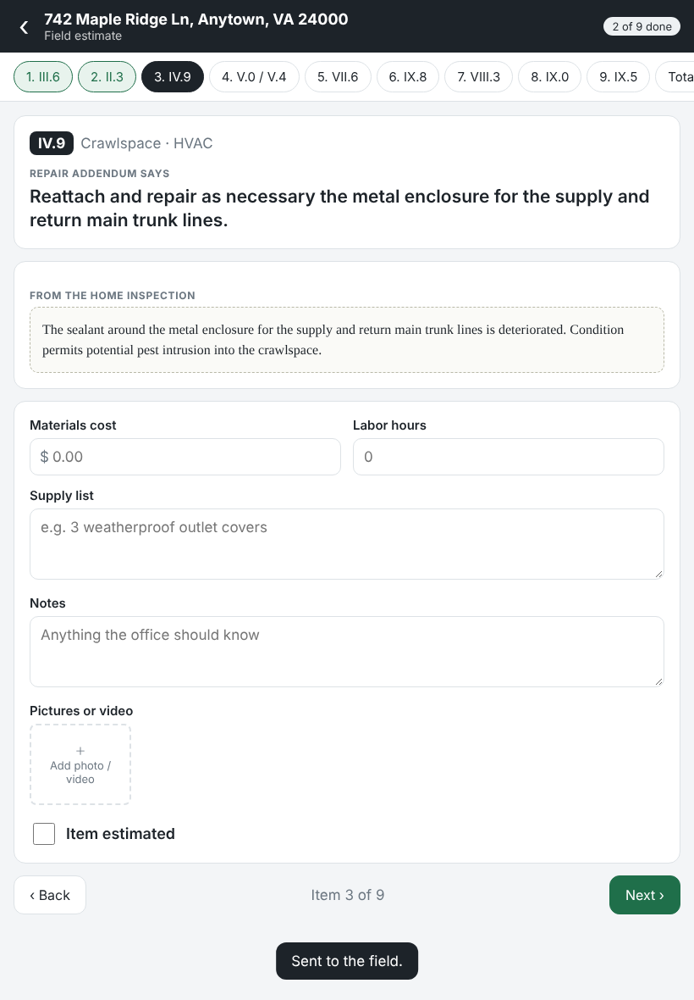
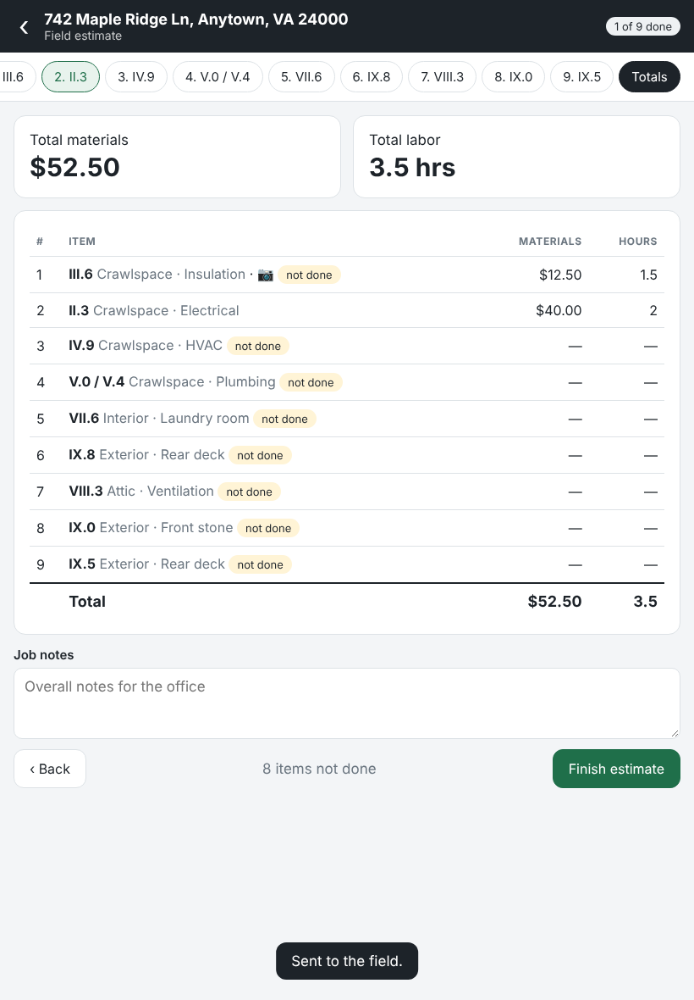
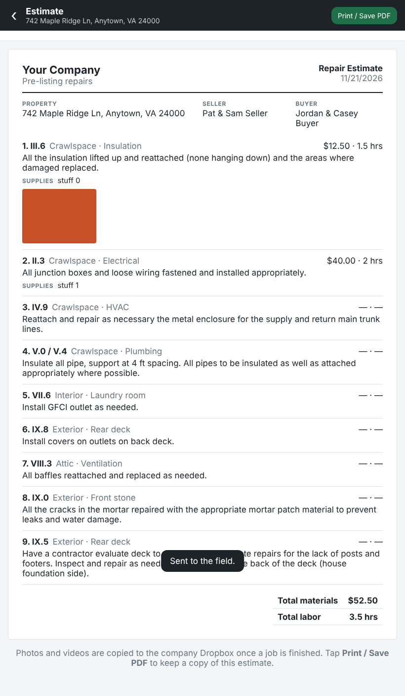

# Field Estimate

**A tablet app that turns repair paperwork into an on-site estimate.**

Built for a Virginia pre-listing repair company. After a home inspection, they get two PDFs by email: the signed **repair addendum** and the **inspection report**. Before this app, estimators had to dig through full inspection reports on site. Now:

1. **AI reads both PDFs** (Claude, with structured tool output) and builds one checklist. It matches addendum items to inspector findings across any numbering style (IV.9, 3.1.5, B-2), merges combined items, and flags anything it can't match.
2. **The office reviews it** and sends it to the field.
3. **The estimator walks the house** one item per page, entering materials cost, labor hours, supplies, notes, and photos or video.
4. **Totals and a printable estimate** are generated. Photos are archived to the company Dropbox, and storage is cleaned up automatically.

**Stack:** vanilla JS (no build step, installable on a tablet's home screen) · Supabase (Postgres with row-level security, Storage, Auth, Edge Functions, pg_cron) · Claude API (PDF document input + forced tool use) · Dropbox API (OAuth refresh-token flow) · n8n (email intake) · Playwright and Node tests.

Runs in **demo mode** with no backend: serve `app/` and tap **Load sample job** (the sample is fictional).

| Field checklist | Totals | Printable estimate |
|---|---|---|
|  |  |  |

## What's in this folder

| Path | What it is |
|---|---|
| `app/` | The web app itself (plain HTML/JS — no build step). Works on any tablet browser and can be added to the home screen. |
| `app/config.js` | The only file you edit: Supabase keys + company name. Empty keys = **demo mode**. |
| `supabase/schema.sql` | Creates the database tables, security rules and photo/video storage. |
| `supabase/functions/extract-job/` | The AI step that reads the two PDFs and builds the checklist (Claude). |
| `tests/` | Automated tests (`node tests/core.test.mjs`, `python3 tests/e2e.py` with the app served on port 8765). |

## Screens

1. **Jobs**: every job with its status (Being set up → Ready for field → Estimate done).
2. **New job**: either **Read PDFs** (upload addendum + report and the AI fills in the items) or **Start empty job** (type it in).
3. **Office**: the receptionist checks or edits each item (number, area, addendum wording, inspection wording, an optional inspection screenshot, an optional flag), reorders or deletes items, then taps **Send to field**.
4. **Field**: one page per item ("Item 3 of 9") with materials cost, labor hours, supply list, notes, photos/video, and an "Item estimated" checkbox. A tab bar jumps between items.
5. **Totals**: materials and hours added up. Tap any row to go back to it. **Finish estimate** marks the job done.
6. **Estimate**: a clean printable page. **Print / Save PDF** uses the tablet's print menu (Save as PDF works there).

## Try it right now (demo mode)

Open `app/index.html` through any web server (e.g. `python3 -m http.server -d app`), or deploy as below with `config.js` left empty. Tap **Load sample job** for the 742 Maple Ridge Ln job. Demo data is saved only on that one device.

## Going live: about 45 minutes, one time

### 1. Supabase project (database + file storage) — free to start
1. Create a free account at supabase.com → **New project** (name it `field-estimate`, region East US). Save the database password somewhere safe.
2. **SQL Editor → New query** → paste all of `supabase/schema.sql` → **Run**.
3. **Authentication → Users → Add user**: create a login for each person (office + each estimator). Turn **off** "Allow new users to sign up" under Authentication → Sign In / Providers, so only people you add can get in.

### 2. Connect the app
**Project Settings → API**: copy the **Project URL** and the **anon public** key into `app/config.js`.
(The anon key is safe in the app; the database only lets signed-in users in.)

### 3. Put the app online — free
Netlify or Vercel: drag the `app/` folder in (Netlify → "Deploy manually"). You get a link like `your-estimate.netlify.app`. On each tablet, open the link → Share → **Add to Home Screen**.

### 4. Turn on the AI PDF reading
1. Get an Anthropic API key (console.anthropic.com → API Keys). Put $10–20 of credit on it; each job costs a few cents.
2. Install the Supabase CLI, then from this folder:
   ```
   supabase login
   supabase link --project-ref <your project ref>
   supabase secrets set ANTHROPIC_API_KEY=sk-ant-... INTAKE_SECRET=<make up a long random password>
   supabase functions deploy extract-job --no-verify-jwt
   ```
   (`--no-verify-jwt` is fine: the function checks the signed-in user or the intake secret itself.)
   Optional: `ANTHROPIC_MODEL` to choose a different Claude model (default `claude-sonnet-5-5`).
3. In the app: **New job → Read PDFs**. Always have the office check the result before sending it to the field. Anything the AI wasn't sure about is flagged on the item or noted at the top of the job.

### 5. Automatic email intake (optional, n8n or Make)
Have the company forward addendum emails to one inbox (or set a Gmail filter). In n8n:
1. **Gmail Trigger** (new email with attachments, "Download attachments" on).
2. **Code node** to pick the two PDFs:
   ```js
   const item = $input.first();
   const keys = Object.keys(item.binary || {}).filter(k => (item.binary[k].mimeType || '').includes('pdf'));
   const addKey = keys.find(k => /addend/i.test(item.binary[k].fileName || '')) || keys[0];
   const repKey = keys.find(k => k !== addKey);
   if (!addKey || !repKey) throw new Error('Expected 2 PDF attachments');
   const b64 = async k => (await this.helpers.getBinaryDataBuffer(0, k)).toString('base64');
   return [{ json: { addendum_pdf: await b64(addKey), report_pdf: await b64(repKey), save: true } }];
   ```
   (If attachments are named oddly, the AI also checks which is which by content.)
3. **HTTP Request**: POST `https://<project-ref>.supabase.co/functions/v1/extract-job`, JSON body = the Code node output, headers `x-intake-secret: <INTAKE_SECRET>` and `Authorization: Bearer <anon key>`.
The job appears in the app as **Being set up** for the office to check.

## Save photos and videos to the company Dropbox
When a job is finished, its photos, videos, inspection screenshots and a `summary.txt` (items, costs, hours, notes) are copied to Dropbox:
`/Estimate Jobs/2026-11-20 - 742 Maple Ridge Ln Anytown/01 II.3 Crawlspace Electrical/field-1-....jpg`
The job list shows **Saved to Dropbox** when it's done. If Dropbox is unreachable, it retries every 15 minutes.

1. Signed in to the **company** Dropbox, go to dropbox.com/developers/apps → **Create app** → Scoped access → **Full Dropbox** → name it `Field Estimate`.
2. **Permissions** tab: tick `files.content.write` and `files.content.read` → Submit.
3. **Settings** tab: copy the App key and App secret.
4. In a browser (signed in to the company Dropbox), open
   `https://www.dropbox.com/oauth2/authorize?client_id=<APP_KEY>&response_type=code&token_access_type=offline`
   → Allow → copy the code it shows.
5. Swap the code for a long-lasting refresh token:
   ```
   curl https://api.dropboxapi.com/oauth2/token -d code=<CODE> -d grant_type=authorization_code -u <APP_KEY>:<APP_SECRET>
   ```
   Copy `refresh_token` from the reply.
6. `supabase secrets set DROPBOX_APP_KEY=... DROPBOX_APP_SECRET=... DROPBOX_REFRESH_TOKEN=...` (optional `DROPBOX_ROOT="/Estimate Jobs"`), then `supabase functions deploy archive-to-dropbox --no-verify-jwt`.
7. Schedule the retry (SQL Editor, same as the cleanup below, every 15 minutes):
   ```sql
   select cron.schedule('archive-dropbox', '*/15 * * * *', $$
     select net.http_post(
       url := 'https://<project-ref>.supabase.co/functions/v1/archive-to-dropbox',
       headers := '{"Content-Type":"application/json","x-intake-secret":"<INTAKE_SECRET>"}'::jsonb,
       body := '{}'::jsonb);
   $$);
   ```
Dropbox Business with a shared **team folder**: if files land in a personal folder instead of the team space, set `DROPBOX_TEAM_ROOT` to the team's root namespace id (Dropbox API `users/get_current_account` → `root_info.root_namespace_id`).

## Automatic photo/video cleanup (every 90 days)
With Dropbox set up, the app only deletes its copies **after** they're saved in Dropbox, so you can safely shorten this to 30 days (`MEDIA_KEEP_DAYS=30`) to keep storage costs down.
Photos and videos from jobs marked **Estimate done** more than 90 days ago are deleted automatically. The job, items, costs, hours and notes stay. **Save each finished estimate as a PDF** (Print / Save PDF), which keeps a copy of the photos.

1. Deploy: `supabase functions deploy cleanup-media --no-verify-jwt` (uses the same `INTAKE_SECRET`). Optional: `supabase secrets set MEDIA_KEEP_DAYS=60` to change the 90 days.
2. Supabase → **Database → Extensions**: turn on `pg_cron` and `pg_net`.
3. **SQL Editor**, run once (fill in your project ref and secret):
   ```sql
   select cron.schedule('cleanup-media-daily', '0 7 * * *', $$
     select net.http_post(
       url := 'https://<project-ref>.supabase.co/functions/v1/cleanup-media',
       headers := '{"Content-Type":"application/json","x-intake-secret":"<INTAKE_SECRET>"}'::jsonb,
       body := '{}'::jsonb);
   $$);
   ```
   It runs daily at 2–3 a.m. Eastern (7:00 UTC) and only removes media past the 90-day mark.

## Costs
- Supabase: free tier (500 MB database, 1 GB files). Videos fill storage fastest; the app refuses videos over 50 MB (the free plan's per-file limit) and shrinks photos to 1600 px. Move to the Pro plan when storage runs out.
- Netlify/Vercel: free.
- Claude: a few cents per job.

## Known limits / next steps
- Very large inspection reports (over ~100 pages or ~30 MB) may be too big for the AI. Use the shorter request list, or split the PDF.
- The inspection screenshot is added by hand (Office screen). Automatic cropping from the PDF is a possible upgrade.
- Two people editing the same item at the same moment: the last save wins.
- Demo mode keeps data on one device only. Use live mode for real work.
